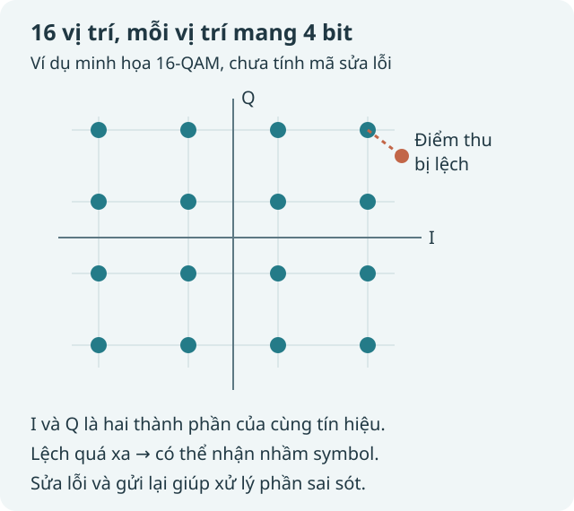
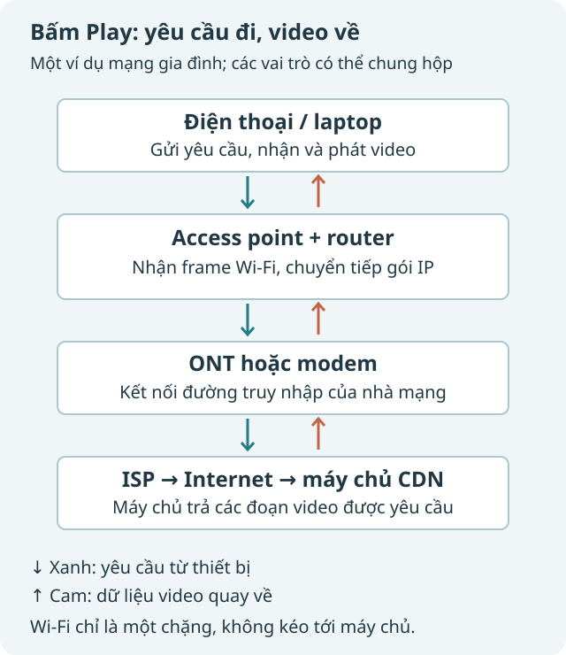
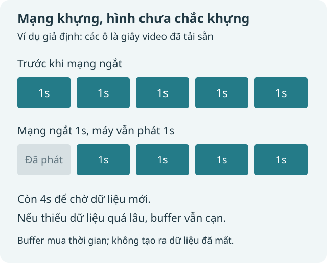

Mình bấm Play. Nhân vật trên màn hình bắt đầu chạy, nhạc nổi lên, phụ đề hiện ra. Chuyện quá quen đến mức gần như chẳng còn gì đáng hỏi.

Nhưng khoan. Điện thoại không có sợi dây nào nối với cục mạng. Trong phòng cũng chẳng có chữ số nào đang bay lơ lửng. Vậy cái gì vừa đi xuyên qua không khí, rồi bằng cách nào lại thành đúng tập phim mình muốn xem?

Câu trả lời đi qua vài thứ nghe hơi đáng ngại: điều chế, frame, router, TCP, QUIC. Nhưng ta không cần nuốt cả cuốn giáo trình mạng. Cứ theo một lần bấm Play, đi từng chặng là được.

## 1. Wi-Fi không phải cứ rung ở một tần số là có Internet

Hãy hình dung một người thổi còi. Nếu người ấy giữ nguyên một tiếng còi mãi, ta biết có người đang thổi, nhưng chưa nhận được câu chuyện nào. Muốn truyền tin, hai bên cần thống nhất: thay đổi tiếng còi như thế nào thì mang ý nghĩa gì.

Sóng điện từ cũng vậy. Tần số như 2,4 GHz hay 5 GHz cho biết vùng sóng mang được sử dụng, chứ bản thân con số ấy không phải nội dung bộ phim. Dữ liệu được đặt lên tín hiệu bằng những biến đổi có quy tắc.

Một cách phổ biến là **QAM**: thay đổi phối hợp biên độ và pha. Nói gần gũi hơn, phía phát có một bảng các trạng thái tín hiệu; mỗi trạng thái đại diện cho một nhóm bit. Phía thu đo tín hiệu rồi suy ra trạng thái nào đã được gửi.

Ví dụ, 16-QAM có 16 trạng thái. Bốn bit tạo ra 16 tổ hợp, nên một trạng thái có thể mang bốn bit. Đây là số bit ánh xạ vào một symbol, chưa trừ phần dành cho sửa lỗi và các thông tin phụ. [Giải thích QAM của Huawei](https://info.support.huawei.com/info-finder/encyclopedia/en/detail?action=queryEntityDetail&keyword=QAM)

*Các chấm là vị trí tín hiệu lý tưởng. Điểm thu thực tế có thể lệch; phía thu phải quyết định nó gần trạng thái nào.*

Nếu nhét nhiều trạng thái hơn vào cùng một vùng tín hiệu, mỗi lần gửi có thể mang nhiều bit hơn. Nhưng các điểm cũng gần nhau hơn. Chỉ cần nhiễu đủ lớn, phía thu dễ nhầm điểm này sang điểm bên cạnh.

Vì thế, tốc độ Wi-Fi không chỉ phụ thuộc việc mua “cục mạng mạnh”. Thiết bị còn phải chọn cách truyền phù hợp với chất lượng đường vô tuyến: môi trường tốt có thể dùng chế độ mang nhiều dữ liệu hơn; đường xấu phải dè chừng hơn.

## 2. Anten thu sóng, còn con chip làm phần việc khó

Anten không tự hiểu 0 và 1. Nó tạo ra một tín hiệu điện tương ứng với trường điện từ thu được. Mạch vô tuyến xử lý tín hiệu ấy, rồi hệ thống lấy mẫu để phần xử lý số có thể làm việc.

Rắc rối là tín hiệu nhận được không sạch. Nó lẫn nhiễu, gặp phản xạ từ tường và đồ vật, đến anten qua nhiều đường khác nhau. Giống như nghe một câu nói trong căn phòng vang: câu nói vẫn ở đó, nhưng bị trộn với tiếng vọng.

Với nhiều chế độ Wi-Fi hiện đại, **OFDM** chia việc truyền dữ liệu trên nhiều sóng mang con được sắp xếp trực giao. Phía thu dùng các phép xử lý, trong đó có FFT, để tách các thành phần ấy. Từ phần tín hiệu đã biết trước và các tín hiệu tham chiếu, nó đồng bộ và ước lượng ảnh hưởng của đường truyền, rồi giải điều chế và giải mã sửa lỗi.

Không cần tính FFT bằng tay để hiểu ý chính: **thiết bị biết quy tắc phát, đo tín hiệu nhận được, bù một phần méo mó, rồi suy ra dữ liệu**. Những quy tắc ấy nằm trong chuẩn Wi-Fi và các chế độ truyền hai phía hỗ trợ. [Tổng quan WLAN của Rohde & Schwarz](https://www.rohde-schwarz.com/us/products/test-and-measurement/digital-standards/wlan-802.11-digital-standards_333599.html)

Chỗ này có một từ dễ gây nhầm: “giải mã”.

- **Giải điều chế:** từ tín hiệu suy ra các symbol, bit.
- **Giải mã sửa lỗi:** dùng phần dư thừa để phục hồi được một số sai sót.
- **Giải mã bảo mật:** cần khóa để đọc dữ liệu đã mã hóa.

Đó là những việc khác nhau. Cục mạng nhận được frame Wi-Fi không có nghĩa nó tự đọc được nội dung HTTPS bên trong.

Và khi video đang tải về, chính card Wi-Fi trong điện thoại đang làm vai trò thu này. Cục phát không phải phía duy nhất biết đọc sóng.

## 3. “Cục modem” trong nhà có thể đang làm mấy nghề

Ta thường gọi chung chiếc hộp có anten là modem. Nhưng bên trong nó có thể là nhiều vai trò gộp lại.

| Vai trò | Công việc chính |
| --- | --- |
| Access point, viết tắt AP | Là đầu bên kia của chặng Wi-Fi, nối thiết bị không dây vào mạng cục bộ |
| Router | Chuyển tiếp gói IP giữa các mạng |
| Modem hoặc ONT | Kết cuối đường truy nhập của nhà mạng; ONT dùng trong mạng quang |
| CPE | Tên gọi nhóm thiết bị phía khách hàng, không phải một công đoạn bắt buộc nằm sau modem |

Gateway gia đình còn thường kiêm switch, firewall, DHCP và NAT cho IPv4. Mạng nhà khác có thể tách các chức năng ấy thành nhiều thiết bị.

Mình dùng sơ đồ dưới đây như một ví dụ, không phải công thức lắp mạng cho mọi nhà:

*Mũi tên xanh là yêu cầu đi ra, màu cam là video quay về. Những vai trò ở giữa có thể chung một chiếc hộp.*

Điều quan trọng: **sóng Wi-Fi chỉ đi qua một chặng của hành trình**. AP nhận một frame trên liên kết Wi-Fi, rồi dữ liệu được chuyển tiếp qua những liên kết khác. Không có một làn sóng từ điện thoại bay nguyên vẹn tới máy chủ ở bên kia đại dương.

Router nhìn thông tin của gói IP để quyết định chuyển nó tới đâu tiếp theo. Trên mỗi liên kết, cách đóng khung và mang dữ liệu có thể thay đổi; một số trường IP cũng thay đổi khi được chuyển tiếp. [RFC 1812, phần chuyển tiếp gói](https://www.rfc-editor.org/info/rfc1812/)

Ví dụ, điện thoại có địa chỉ nội bộ như `192.168.1.23`. Với một mạng IPv4 gia đình dùng NAT, gateway thường ánh xạ địa chỉ và cổng nguồn nội bộ sang địa chỉ, cổng ở phía Internet, rồi dùng bảng trạng thái để đưa lưu lượng trả về đúng thiết bị. Không phải cứ gói tới nhà là mọi máy trong nhà đều nhận cùng một bản. Đây là ví dụ NAT IPv4; không nên áp nó như quy luật bắt buộc cho mọi mạng, nhất là IPv6. [Thuật ngữ và cơ chế NAT trong RFC 2663](https://www.rfc-editor.org/rfc/rfc2663.html)

## 4. Bấm Play thì điện thoại tìm ai?

Trước hết, ứng dụng cần biết phải nói chuyện với dịch vụ nào. DNS tham gia việc tìm địa chỉ cho tên miền; ứng dụng thiết lập kết nối và gửi những yêu cầu cần thiết. Với HTTPS, nội dung trao đổi được bảo vệ bằng TLS.

Ở đây, hai lớp bảo vệ thường bị gọi lẫn:

**Bảo mật Wi-Fi** bảo vệ chặng vô tuyến giữa thiết bị và AP. **TLS** bảo vệ dữ liệu tới đầu cuối TLS, có thể là một máy chủ của nền tảng hoặc hệ thống CDN. Router gia đình thông thường vẫn chuyển tiếp được lưu lượng mà không cần đọc cuộc hội thoại HTTPS.

Để phát video, trình phát thường lấy một bản mô tả: có những bản chất lượng nào, và cần lấy các đoạn media ở đâu. HLS gọi bản danh sách ấy là playlist. Video có thể được cung cấp thành nhiều đoạn để máy tải và phát dần. [Đặc tả HLS](https://www.rfc-editor.org/info/rfc8216/)

Đừng nhầm **đoạn video** với **packet mạng**. Một đoạn media có thể cần nhiều packet để vận chuyển. Nhận đủ dữ liệu rồi, máy vẫn còn công việc của codec: giải mã video thành hình, âm thanh thành tiếng, và sắp chúng theo thời gian phát.

Máy chủ đưa các đoạn ấy về cũng không nhất thiết là máy chủ gốc của cả dịch vụ. CDN lưu và phục vụ nội dung từ nhiều vị trí, giúp đưa nó gần người xem hơn trong nhiều trường hợp. [Cách phân phối video qua CDN](https://www.cloudflare.com/learning/video/what-is-streaming/)

## 5. Một gói bị mất: ai nhận ra, ai sửa?

Có ít nhất ba việc phải tách ra: **phát hiện sai, sửa được sai, và xin gửi lại**.

Ở tầng vật lý, mã sửa lỗi thêm phần dư thừa có cấu trúc. Nhờ đó, phía nhận có thể phục hồi một số lỗi mà không cần hỏi lại phía phát. Dĩ nhiên, khả năng này có giới hạn.

Một phép ví von rất đơn giản: nếu một thông tin được lặp lại đủ lần, phía thu có thể đối chiếu khi một lần bị nhiễu. Mã sửa lỗi thực tế tinh vi hơn việc lặp nguyên bản, nhưng vẫn dựa vào ý tưởng dùng thông tin dư thừa để tăng cơ hội khôi phục.

Frame Wi-Fi còn có phần kiểm tra lỗi như FCS dùng CRC. Nó giúp phát hiện nhiều dạng hỏng dữ liệu; **CRC tự nó không sửa những bit hỏng**.

Với nhiều kiểu truyền unicast, Wi-Fi dùng xác nhận ACK hoặc Block ACK. Nếu không nhận được xác nhận cần thiết, phía gửi có thể thử gửi lại theo cơ chế của liên kết. [Tổng quan 802.11 về độ tin cậy trên liên kết](https://datatracker.ietf.org/meeting/114/materials/slides-114-manet-80211-mesh-network-00.pdf)

Nhưng một ACK của Wi-Fi chỉ nói về chặng đó. Nó không phải biên nhận từ máy chủ cuối cùng.

Một frame có thể tới AP ngon lành, rồi dữ liệu tiếp tục đi tới một router đang đầy hàng đợi và bị bỏ. Vì vậy, “Wi-Fi đầy vạch” không đồng nghĩa với “đường tới dịch vụ không bao giờ mất gói”.

## 6. TCP và QUIC cứu phần việc ngoài chặng Wi-Fi

Nếu ứng dụng sử dụng một kết nối truyền dữ liệu đáng tin cậy, hai đầu kết nối còn có cơ chế riêng để theo dõi dữ liệu thiếu và phục hồi.

Với TCP, ứng dụng nhận một dòng byte có thứ tự. Dữ liệu thiếu ở giữa có thể khiến phần sau phải chờ trước khi được giao theo thứ tự cho ứng dụng. Bên dưới vẻ liền mạch ấy là xác nhận, số thứ tự và các cơ chế truyền lại.

QUIC chạy trên UDP, nhưng không vì thế mà mọi dữ liệu mất đều bị bỏ mặc. Các **reliable stream** của QUIC vẫn có việc đảm bảo thứ tự và phục hồi dữ liệu thiếu. [RFC 9000](https://datatracker.ietf.org/doc/html/rfc9000)

Một lợi ích khi HTTP/3 dùng QUIC là các stream có thể tiến triển độc lập hơn: dữ liệu mất ở một stream không mặc nhiên bắt các stream độc lập khác phải chờ cùng nó ở tầng truyền tải.

Tuy nhiên, không nên rút gọn thành “HTTP/3 không sợ mất gói”. Dữ liệu bị ảnh hưởng vẫn cần được xử lý; các stream còn chia sẻ những giới hạn như tắc nghẽn của kết nối và năng lực đường truyền. [RFC 9114](https://www.rfc-editor.org/rfc/rfc9114.html)

Gửi lại cũng không miễn phí. Nó tốn thêm dung lượng và thời gian. Khi đường đã nghẽn, cứ cố nhồi thêm dữ liệu có thể làm tình hình xấu hơn; đó là lý do cần kiểm soát tắc nghẽn.

## 7. Vì sao gói mất mà phim chưa đứng hình?

Bởi màn hình không nhất thiết đang phát đúng phần dữ liệu vừa mới tới.

Trình phát giữ một lượng video đã tải sẵn: **buffer**. Trong lúc mình xem phần trước, nó có thời gian lấy phần sau.

*Đây là ví dụ giả định để hình dung, không phải lời hứa rằng mọi mạng ngắt một giây đều được che giấu.*

Giả sử máy đã có sẵn năm giây video, rồi mạng ngừng đưa dữ liệu về trong một giây. Trong điều kiện phát bình thường, máy vẫn tiêu thụ một giây đã có và còn bốn giây để chờ. Nếu kết nối phục hồi kịp, mình có thể không nhận ra gián đoạn vừa xảy ra.

Nhưng buffer không sinh ra dữ liệu. Nếu tốc độ tải hữu ích thiếu hụt kéo dài, phần tích trữ sẽ cạn và phim phải chờ.

Một cách khác là **adaptive bitrate**: trình phát chọn bản chất lượng phù hợp hơn với tốc độ tải quan sát được và trạng thái của nó. Mạng không đủ để giữ bản cao thì có thể chuyển xuống bản nhẹ hơn. Mình thấy hình mềm đi, nhưng câu chuyện vẫn tiếp tục. [RFC 9317 về vận hành streaming](https://www.rfc-editor.org/rfc/rfc9317.html)

Thế nên “phim không giật” và “phim luôn giữ độ nét cao nhất” là hai mục tiêu khác nhau. Có lúc hệ thống phải đánh đổi.

## 8. Nhiều buffer hơn chưa chắc luôn tốt

Có hai cái “chờ” khác nhau.

Một bên là trình phát chủ động giữ video để dành. Bên kia là packet xếp hàng quá lâu trong thiết bị mạng trước khi được gửi đi.

Nếu hàng đợi mạng phình quá mức, thao tác cần phản hồi nhanh có thể chậm hẳn dù đường truyền vẫn tải được nhiều dữ liệu. Hiện tượng này thường được gọi là **bufferbloat**.

Một số kỹ thuật quản lý hàng đợi, chẳng hạn FQ-CoDel, kết hợp phân chia luồng và quản lý hàng đợi chủ động để hạn chế trễ kéo dài. Đôi khi chủ động loại bỏ hoặc đánh dấu một số gói đúng cách lại giúp các đầu gửi phản ứng trước tắc nghẽn, thay vì để mọi thứ nằm chờ mãi. [RFC 8290](https://datatracker.ietf.org/doc/html/rfc8290)

Điểm cần nhớ không phải “buffer xấu”. Mà là phải hỏi: buffer nằm ở đâu, giữ thứ gì, và giữ lâu đến mức nào?

## 9. Nếu là cuộc gọi video thì sao?

Xem một tập anime có thể chấp nhận bắt đầu muộn một chút để tải trước. Cuộc gọi thì khó làm vậy. Nếu mỗi người nghe đối phương trễ thêm vài giây, câu chuyện sẽ thành hai người liên tục nói chồng lên nhau.

Media tương tác thường có ngân sách thời gian chặt hơn. Một **jitter buffer** nhỏ giúp hấp thụ dao động thời gian đến, nhưng tăng khoảng chờ cũng tăng độ trễ.

Khi phát hiện thiếu gói, phía nhận có thể xin gửi lại bằng phản hồi NACK. Tuy nhiên, bản gửi lại phải đến trước hạn phát mới còn hữu ích. Nếu lời chào đã cần phát ở thời điểm đó, nhận lại nó quá muộn không cứu được cuộc hội thoại. [RTP và truyền lại trong WebRTC](https://datatracker.ietf.org/doc/rfc8834/)

Một lựa chọn khác là gửi thêm dữ liệu sửa lỗi FEC từ trước, để phía nhận có cơ hội phục hồi mà không chờ một vòng hỏi đáp. Cái giá là tiêu tốn thêm băng thông. Khi không phục hồi kịp, bộ giải mã còn có thể dùng kỹ thuật che giấu lỗi để giảm mức khó chịu. [Các đánh đổi FEC của WebRTC](https://www.rfc-editor.org/rfc/rfc8854.html)

Các hệ thống phối hợp những cách này tùy điều kiện. Và không phải mọi livestream đều là WebRTC: có những hệ thống live dùng HLS, với mục tiêu độ trễ khác.

| Khi cần… | Hệ thống có thể ưu tiên… |
| --- | --- |
| Xem phim ít đứng hình | Tải trước, phục hồi dữ liệu thiếu, điều chỉnh chất lượng |
| Gọi video phản hồi nhanh | Giới hạn thời gian chờ, chỉ phục hồi khi còn kịp, che giấu một phần lỗi |
| Tải file chính xác | Nhận đủ dữ liệu, chấp nhận mất thêm thời gian |

## 10. Vậy bộ phim đã đi qua những gì?

Từ máy chủ, dữ liệu đi qua mạng dưới dạng các gói. Tới chặng Wi-Fi, nó được mang bằng tín hiệu vô tuyến. Điện thoại thu tín hiệu, khôi phục dữ liệu, xử lý các lớp giao thức và bảo mật, rồi bộ giải mã media biến những byte đã nhận thành hình và tiếng.

Trong hành trình ấy, lỗi có thể đã xảy ra. Một phần được sửa ngay ở liên kết. Một phần được gửi lại. Một khoảng chờ được buffer hấp thụ. Có lúc trình phát giảm chất lượng để theo kịp.

**Phim chạy mượt không có nghĩa đường truyền hoàn hảo. Nó có thể chỉ có nghĩa là những tầng ở giữa đã kịp xử lý trước khi mình nhận ra.**

Còn khi mọi khoảng dự phòng đều cạn, chiếc vòng tròn loading xuất hiện. Không có phép màu nào bảo đảm vừa đủ dữ liệu, vừa không trễ, vừa giữ chất lượng tối đa trên mọi đường mạng.

Nhưng nghĩ lại, để một câu thoại đến đúng lúc giữa một căn phòng đầy sóng và nhiễu, chừng ấy tầng phối hợp được với nhau cũng đã khá kỳ diệu rồi.

---

*Sơ đồ trong bài là minh họa giản lược do blog dựng lại. Các ví dụ về buffer là tình huống giả định. Chế độ Wi-Fi, giao thức và cách điều chỉnh chất lượng cụ thể còn tùy thiết bị và dịch vụ.*
