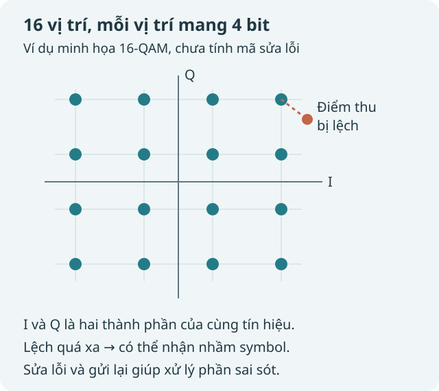
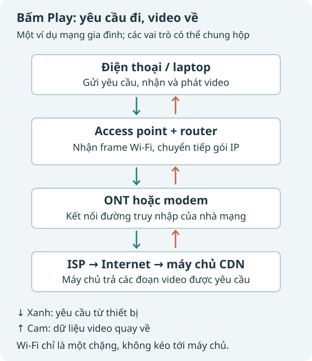
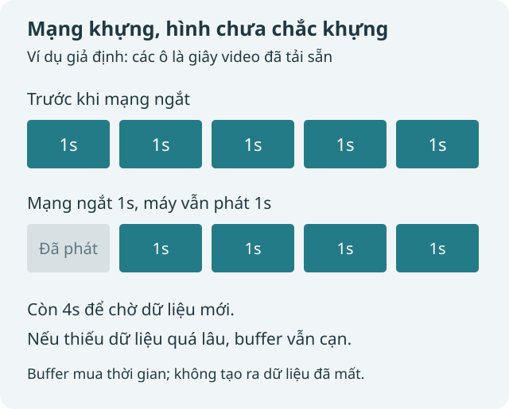

*Có những hành trình dài hàng nghìn cây số, diễn ra trong khoảng thời gian ngắn đến mức chúng ta chẳng kịp nhận ra.*

---

Đêm đã khuya.

Tôi ngồi trước màn hình máy tính, mở một tập anime còn xem dở từ tối hôm trước. Ngoài cửa sổ, Sài Gòn vẫn chưa ngủ. Tiếng xe máy thỉnh thoảng vọng lên từ con đường nhỏ, hòa cùng tiếng quạt máy quay đều trong căn phòng.

Tôi nhấn Play.

Một giây sau, nhạc mở đầu vang lên. Những khung hình nối tiếp nhau, nhân vật bắt đầu cất tiếng nói, phụ đề hiện ra đúng lúc. Mọi thứ tự nhiên đến mức chẳng ai buồn thắc mắc.

Nhưng có một điều khiến tôi chợt nghĩ ngợi.

Máy tính của tôi không hề được nối với Internet bằng dây mạng. Giữa nó và chiếc router đặt ở góc phòng chỉ có vài mét không khí, một bức tường, cùng vô số tín hiệu điện từ mà mắt thường không thể nhìn thấy.

Vậy bằng cách nào, từ một máy chủ nào đó cách đây hàng trăm, thậm chí hàng nghìn cây số, những hình ảnh và âm thanh lại có thể tìm đến đúng chiếc máy tính của tôi?

Làm sao những con số không có hình hài có thể vượt qua tường gạch, đường dây, những thiết bị trung gian, rồi cuối cùng trở thành một bầu trời đầy sao, một giọng nói quen thuộc, hay một bản nhạc khiến người ta bất giác nhớ đến những năm tháng đã qua?

Tôi tạm dừng bộ phim.

Có lẽ, trước khi tiếp tục câu chuyện trên màn hình, chúng ta nên thử tìm hiểu câu chuyện đang diễn ra phía sau nó.

## I. Không khí không mang những con số

Chúng ta thường nói rằng Wi-Fi truyền dữ liệu qua không khí.

Câu nói ấy đúng, nhưng vẫn còn một khoảng cách khá xa giữa việc hiểu rằng dữ liệu được truyền đi và hiểu nó thực sự được truyền như thế nào.

Bởi trong không khí chẳng có những con số 0 và 1 đang bay qua bay lại.

Thứ đang lan truyền là sóng điện từ.

Hãy tưởng tượng hai người đứng trên hai ngọn đồi, cách nhau một thung lũng. Họ không thể nghe thấy tiếng nói của nhau, nhưng có thể nhìn thấy ánh đèn từ phía đối diện.

Nếu người thứ nhất chỉ bật đèn liên tục, người bên kia nhiều nhất cũng chỉ biết rằng có ai đó đang phát sáng.

Nhưng nếu cả hai thống nhất từ trước rằng một lần nháy đèn mang ý nghĩa này, hai lần nháy đèn mang ý nghĩa khác, họ đã có thể bắt đầu trao đổi thông tin.

Wi-Fi phức tạp hơn chuyện nháy đèn rất nhiều, nhưng nguyên lý nền tảng cũng tương tự.

Thiết bị phát tạo ra một tín hiệu điện từ, rồi thay đổi những đặc tính của tín hiệu ấy theo các quy tắc đã thống nhất. Thiết bị thu quan sát những thay đổi này để suy ra thông tin được gửi đến.

Quá trình ấy gọi là **điều chế tín hiệu**.

Chẳng hạn, một kỹ thuật phổ biến có tên Quadrature Amplitude Modulation, hay QAM, sử dụng sự kết hợp giữa biên độ và pha của tín hiệu để biểu diễn thông tin.

Với 16-QAM, chúng ta có 16 trạng thái tín hiệu khác nhau. Vì 16 bằng 2 mũ 4, mỗi trạng thái lý tưởng có thể biểu diễn 4 bit thông tin trước khi tính đến mã sửa lỗi và những phần phụ trợ.

Nếu hình dung mỗi trạng thái là một vị trí trên bản đồ, phía phát sẽ lần lượt lựa chọn các vị trí tương ứng với dữ liệu cần gửi. Phía thu quan sát tín hiệu nhận được và cố gắng xác định vị trí mà phía phát đã lựa chọn.

Nghe có vẻ đơn giản.

Nhưng vấn đề là tín hiệu không bao giờ có được một chuyến đi hoàn toàn bình yên.

Nó có thể bị suy yếu bởi khoảng cách, bị ảnh hưởng bởi nhiễu, phản xạ từ tường, trần nhà và những vật dụng trong phòng. Có những thành phần tín hiệu đến anten thu theo đường thẳng, cũng có những thành phần phải đi qua nhiều lần phản xạ.

Thế là cùng một thông điệp, phía nhận có thể quan sát thấy nhiều bản sao bị trễ và biến dạng.

Để xử lý môi trường ấy, Wi-Fi hiện đại sử dụng nhiều kỹ thuật phối hợp với nhau, trong đó có OFDM, chia dữ liệu lên nhiều sóng mang con trực giao. Phía thu dùng các phép xử lý tín hiệu, bao gồm FFT, để phân tách, ước lượng tác động của đường truyền và khôi phục thông tin.

Những kỹ thuật này không làm cho nhiễu biến mất, nhưng giúp hai thiết bị có thể giao tiếp đáng tin cậy hơn trong một môi trường vốn chẳng mấy lý tưởng.

Điều thú vị là tất cả những việc ấy diễn ra quá nhanh để chúng ta nhận biết bằng giác quan.

Tôi ngồi cách chiếc router vài mét, chẳng nghe thấy âm thanh nào, chẳng nhìn thấy ánh sáng nào phát ra từ nó. Vậy mà mỗi giây, hàng triệu, thậm chí hàng trăm triệu bit thông tin có thể được truyền qua khoảng không gian nhỏ bé ấy, tùy điều kiện kết nối.

Những bit đó không phải là những hạt vật chất bay trong phòng.

Chúng là thông tin được mã hóa vào những biến đổi của tín hiệu vật lý.

**Không khí chẳng biết bộ phim tôi đang xem nói về điều gì. Nó chỉ đang mang những tín hiệu mà con người đã học được cách gửi đi và đọc lại.**

## II. Một bức tường, một chiếc router và cả thế giới phía sau

Giả sử chiếc máy tính đã gửi thành công một yêu cầu qua Wi-Fi.

Nó sẽ đi đâu tiếp theo?

Đây là chỗ chúng ta thường hiểu nhầm chiếc hộp có anten trong nhà.

Phần lớn mọi người gọi nó là modem, hoặc đơn giản hơn, cục Wi-Fi. Nhưng trong một thiết bị mạng gia đình, nhiều chức năng có thể được tích hợp cùng lúc.

Access Point đảm nhiệm kết nối không dây. Router chuyển tiếp gói tin giữa các mạng. ONT, đối với những kết nối cáp quang thích hợp, kết cuối đường truy nhập quang của nhà mạng. Ngoài ra, thiết bị còn có thể đảm nhiệm NAT, DHCP, firewall và một số công việc khác.

Tùy cách lắp đặt, tất cả có thể nằm trong một chiếc hộp, hoặc được chia ra nhiều thiết bị.

Điểm quan trọng là **sóng Wi-Fi không mang dữ liệu đi suốt chặng đường từ nhà tôi đến máy chủ phát anime**.

Nó chỉ đảm nhiệm một đoạn của hành trình.

Khi yêu cầu rời khỏi mạng gia đình, nó có thể tiếp tục được chuyển qua các liên kết quang, thiết bị định tuyến và hệ thống mạng của nhiều đơn vị khác nhau.

Tưởng tượng một lá thư được chuyển qua nhiều bưu cục.

Ở mỗi chặng, phương tiện vận chuyển có thể thay đổi, nhưng thông tin cần giao đến người nhận vẫn được giữ lại theo những quy tắc tương ứng.

Trong mạng máy tính, dữ liệu được tổ chức thành những đơn vị như packet và frame. Router xem thông tin địa chỉ IP để quyết định hướng chuyển tiếp. Trên từng liên kết, dữ liệu lại được đóng khung và truyền bằng những công nghệ phù hợp với liên kết ấy.

Nếu mạng gia đình sử dụng IPv4 với NAT, router còn có thể thay đổi thông tin địa chỉ và cổng để nhiều thiết bị nội bộ cùng sử dụng một địa chỉ IPv4 phía ngoài. Nó lưu trạng thái ánh xạ để những gói phản hồi được đưa về đúng thiết bị.

Điều đó không có nghĩa router biết tôi đang xem tập anime nào.

Với kết nối HTTPS thông thường, dữ liệu ứng dụng được mã hóa bằng TLS. Router vẫn có thể chuyển tiếp lưu lượng dựa trên những thông tin cần thiết cho mạng, nhưng không vì vậy mà đọc được nội dung đã mã hóa.

Tôi bỗng nhận ra, việc truy cập Internet không giống như mở một cánh cửa duy nhất dẫn ra thế giới.

Nó giống như gửi một người đưa thư đi qua một hệ thống đường sá rộng lớn, nơi mỗi ngã rẽ đều có những quy tắc riêng.

Và điều đáng kinh ngạc là người đưa thư ấy thường chỉ cần một khoảng thời gian rất ngắn để hoàn thành nhiệm vụ.

## III. Bộ phim nằm ở đâu?

Khi chúng ta mở một nền tảng xem phim, dữ liệu không nhất thiết được gửi từ một máy chủ duy nhất nằm ở trụ sở của công ty.

Nhiều dịch vụ sử dụng Content Delivery Network, viết tắt là CDN.

Có thể hình dung CDN như một mạng lưới những kho phân phối nội dung được đặt ở nhiều vị trí địa lý khác nhau. Thay vì buộc mọi người xem đều phải tìm đến một máy chủ gốc ở rất xa, hệ thống có thể phục vụ dữ liệu từ một địa điểm phù hợp hơn.

Tất nhiên, vị trí gần hơn về địa lý không tự động bảo đảm đường truyền nhanh hơn. Tuyến mạng, tải hệ thống và nhiều yếu tố khác vẫn có thể ảnh hưởng đến kết quả.

Khi bấm Play, ứng dụng thường phải thực hiện một loạt công việc.

Nó có thể cần dùng DNS để tìm địa chỉ của dịch vụ, thiết lập kết nối bảo mật, xác thực phiên làm việc nếu cần và yêu cầu thông tin về nội dung cần phát.

Đối với hình thức streaming thích ứng như HLS, trình phát có thể nhận một playlist mô tả các phiên bản chất lượng và những đoạn dữ liệu media tương ứng.

Bộ phim dài hai mươi bốn phút mà chúng ta nhìn thấy không nhất thiết được tải về như một tệp nguyên vẹn.

Nó có thể được chia thành nhiều đoạn nhỏ để trình phát lần lượt yêu cầu, tải xuống và xử lý.

Mỗi đoạn media lại có thể được vận chuyển bằng rất nhiều gói tin mạng.

Rồi sau khi nhận đủ dữ liệu cần thiết, máy tính còn phải giải mã định dạng video, khôi phục khung hình, xử lý âm thanh và đồng bộ chúng theo thời gian.

Một nhân vật cất lời trên màn hình, nghe thật tự nhiên.

Nhưng phía sau giọng nói ấy là một chuỗi hoạt động phối hợp giữa ứng dụng, giao thức mạng, phần cứng và các thuật toán xử lý tín hiệu.

Tôi từng nghĩ xem phim qua Internet đơn thuần là tải hình ảnh về máy.

Hóa ra, đó là cả một quá trình tái dựng nội dung từ dữ liệu.

Máy chủ không gửi đến tôi một nhân vật đang chạy dưới cơn mưa.

Nó gửi thông tin đủ để thiết bị của tôi tạo ra những khung hình và âm thanh khiến tôi nhìn thấy cảnh tượng ấy.

## IV. Những gói tin lạc đường

Một câu hỏi khác xuất hiện.

Nếu dữ liệu phải đi qua nhiều chặng như vậy, chuyện gì xảy ra khi một phần của nó bị hỏng hoặc thất lạc?

Điều này thực ra không hề hiếm gặp.

Môi trường vô tuyến có nhiễu. Thiết bị mạng có hàng đợi hữu hạn. Đường truyền có thể bị tắc nghẽn. Một frame có thể bị hỏng trong lúc truyền, một packet có thể bị loại bỏ khi router không còn đủ khả năng tiếp nhận.

Nhưng không phải tất cả những sự cố ấy đều khiến bộ phim dừng lại.

Lý do là hệ thống mạng được thiết kế với nhiều cơ chế xử lý lỗi ở những tầng khác nhau.

Ngay tại chặng Wi-Fi, thiết bị có thể sử dụng mã sửa lỗi để khôi phục một số sai sót từ tín hiệu nhận được. Nếu frame không được nhận thành công, cơ chế xác nhận và truyền lại ở tầng liên kết có thể giúp gửi lại dữ liệu.

Ở đây cần phân biệt ba việc.

Phát hiện dữ liệu bị sai không đồng nghĩa với sửa được dữ liệu ấy. Sửa lỗi bằng thông tin dư thừa cũng khác với yêu cầu phía gửi truyền lại.

Chẳng hạn, CRC trong frame Wi-Fi hỗ trợ phát hiện lỗi, chứ bản thân nó không tự phục hồi các bit bị hỏng.

Đối với nhiều frame unicast, Wi-Fi còn có ACK hoặc Block ACK để xác nhận việc nhận dữ liệu trên liên kết.

Nhưng một xác nhận của Wi-Fi không phải là lời bảo đảm rằng dữ liệu đã tới máy chủ cuối cùng.

Nó chỉ phản ánh một chặng nhất định.

Nếu gói tin đi qua Wi-Fi thành công nhưng tiếp tục bị mất ở một nơi khác trên Internet, những cơ chế ở tầng cao hơn có thể phải xử lý.

Với TCP, hai đầu kết nối sử dụng số thứ tự, xác nhận và truyền lại để cung cấp cho ứng dụng một dòng byte đáng tin cậy, có thứ tự.

QUIC thì hoạt động trên UDP, nhưng các reliable stream của nó vẫn có cơ chế phát hiện mất mát và phục hồi dữ liệu. HTTP/3 sử dụng QUIC còn cho phép nhiều stream tiến triển độc lập hơn trước tình huống một stream gặp mất dữ liệu.

Dĩ nhiên, không có cơ chế nào hoàn toàn miễn phí.

Truyền lại tiêu tốn băng thông và thời gian. Đường truyền càng tắc nghẽn, việc phục hồi dữ liệu càng khó khăn. Bởi thế, các giao thức còn phải điều chỉnh tốc độ gửi và kiểm soát tắc nghẽn.

Và điều đáng chú ý nhất là một packet bị mất không nhất thiết đồng nghĩa với một khung hình bị mất trên màn hình.

Trước khi người xem kịp nhận ra sự cố, dữ liệu có thể đã được phục hồi.

Có những sai sót xảy ra, rồi được khắc phục, mà chúng ta chẳng bao giờ biết đến.

## V. Vì sao mạng chập chờn mà phim vẫn chạy?

Có lẽ đây là phần thú vị nhất trong toàn bộ câu chuyện.

Giả sử tôi đang xem một cảnh phim rất đẹp. Nhân vật đứng dưới bầu trời đêm, những vì sao lặng lẽ chuyển động, nhạc nền bắt đầu vang lên.

Đúng lúc đó, kết nối mạng bị gián đoạn trong một giây.

Nhưng bộ phim vẫn tiếp tục.

Tại sao?

Bởi trình phát không nhất thiết phải chờ từng giây dữ liệu đến rồi mới có thể hiển thị nó.

Thông thường, ứng dụng sẽ tải sẵn một lượng video nhất định và giữ trong **buffer**, hay bộ đệm phát.

Nếu máy tính đã có sẵn năm giây video, thì trong lúc mạng ngừng cung cấp dữ liệu một giây, trình phát vẫn có thể sử dụng phần dữ liệu đã tích lũy.

Sau một giây ấy, giả sử việc phát diễn ra bình thường, lượng dữ liệu dự trữ còn tương đương khoảng bốn giây.

Nếu mạng phục hồi đủ nhanh, người xem có thể chẳng nhận thấy chuyện gì vừa xảy ra.

Tuy nhiên, buffer không tự tạo thêm dữ liệu. Nếu tốc độ tải không theo kịp tốc độ tiêu thụ trong thời gian dài, phần dự trữ sẽ cạn.

Khi ấy, chiếc vòng tròn loading quen thuộc xuất hiện.

Một kỹ thuật khác cũng góp phần giữ cho trải nghiệm xem phim liền mạch là Adaptive Bitrate Streaming, viết tắt là ABR.

Thay vì luôn cố tải phiên bản có chất lượng cao nhất, trình phát có thể lựa chọn chất lượng phù hợp với điều kiện mạng và lượng dữ liệu đang dự trữ.

Khi mạng yếu, hình ảnh có thể giảm từ độ phân giải cao xuống thấp hơn, hoặc giảm bitrate.

Đổi lại, bộ phim có cơ hội tiếp tục phát mà không phải liên tục dừng chờ.

Đó là một sự đánh đổi có chủ đích.

Một hình ảnh kém sắc nét đôi chút đôi khi vẫn tốt hơn một hình ảnh hoàn hảo nhưng cứ ba giây lại đứng hình.

Tuy nhiên, nhiều bộ đệm hơn không phải lúc nào cũng tốt.

Cần phân biệt bộ đệm phát video với hàng đợi packet trong thiết bị mạng. Một bên giúp trình phát chuẩn bị nội dung tương lai, bên còn lại giữ dữ liệu đang chờ được truyền đi.

Khi hàng đợi mạng tích tụ quá nhiều dữ liệu, độ trễ có thể tăng mạnh, tạo ra hiện tượng bufferbloat.

Vì vậy, một đường truyền có tốc độ tải xuống cao vẫn có thể khiến những ứng dụng cần phản hồi nhanh hoạt động rất tệ.

Xem anime và gọi video, xét cho cùng, có những yêu cầu khác nhau.

Một tập phim có thể chấp nhận tải trước vài giây. Nhưng khi hai người đang trò chuyện, việc âm thanh đến muộn vài giây sẽ khiến cả cuộc đối thoại trở nên khó chịu.

Những ứng dụng tương tác thời gian thực thường phải cân nhắc giữa độ trễ, khả năng phục hồi lỗi và chất lượng media. Tùy thiết kế, chúng có thể sử dụng jitter buffer, NACK, FEC hoặc những kỹ thuật che giấu lỗi.

Dữ liệu đến quá muộn đôi khi chẳng còn giá trị.

Một khung hình cần hiển thị ngay lúc này, nếu phải đợi thêm vài giây mới được truyền lại thành công, có thể đã bỏ lỡ thời điểm của nó.

Tôi thấy điều ấy khá thú vị.

Cùng là truyền dữ liệu, nhưng một hệ thống có thể ưu tiên sự đầy đủ, một hệ thống khác lại ưu tiên sự đúng lúc.

Máy tính không chỉ cần biết làm thế nào để đưa thông tin đến nơi.

Nó còn phải biết thông tin ấy cần đến vào lúc nào.

## VI. Một giây bình thường

Tôi quay trở lại tập anime đang xem dở.

Nhân vật vẫn đứng đó, dưới bầu trời đầy sao. Bản nhạc vừa dừng lại tiếp tục vang lên, nối liền một khoảnh khắc mà đối với tôi dường như chẳng có gì đặc biệt.

Nhưng giờ đây, tôi biết trong khoảng thời gian ngắn ngủi ấy đã có rất nhiều chuyện diễn ra.

Một yêu cầu được gửi qua không khí.

Tín hiệu điện từ được anten thu nhận, xử lý và chuyển thành dữ liệu số.

Những gói tin đi qua các thiết bị mạng, được định tuyến đến những hệ thống phục vụ nội dung. Dữ liệu phản hồi trở về qua những liên kết khác nhau, rồi lại được mang trên sóng vô tuyến ở chặng cuối cùng.

Có thể một vài frame đã bị lỗi.

Có thể một số packet từng bị mất.

Có thể trình phát đã âm thầm điều chỉnh bitrate để bảo đảm câu chuyện trên màn hình không bị ngắt quãng.

Cuối cùng, máy tính giải mã những dữ liệu nhận được và biến chúng thành hình ảnh, âm thanh.

Tất cả phối hợp để tạo ra một trải nghiệm giản dị đến mức người ta chẳng còn để ý.

Một cú nhấp chuột.

Một tập phim.

Một buổi tối bình thường.

Trong lịch sử rất dài của nhân loại, khả năng ấy thực ra chỉ mới xuất hiện gần đây.

Tổ tiên chúng ta từng mất nhiều tháng để đưa một bức thư vượt qua đại dương. Có những chuyến đi kéo dài hàng năm, có những lời nhắn gửi chẳng bao giờ đến được tay người nhận.

Ngày nay, một tín hiệu có thể đi qua hàng nghìn cây số trong khoảng thời gian rất ngắn. Nhưng tốc độ truyền thông tin vẫn bị giới hạn bởi vật lý, bởi khoảng cách, năng lực xử lý và những điều kiện của hệ thống.

Chúng ta chưa chiến thắng được mọi giới hạn ấy.

Chúng ta chỉ ngày càng giỏi hơn trong việc sống chung với chúng.

Tôi nghĩ đến những nhà khoa học từng nghiên cứu điện từ trường, những kỹ sư đặt nền móng cho lý thuyết thông tin, những thế hệ đã xây dựng các giao thức, tuyến cáp, bộ xử lý và những hệ thống mạng ngày nay.

Họ chẳng hề biết rằng một trong vô số kết quả từ công việc của mình, nhiều thập kỷ sau, lại là việc một thanh niên có thể nằm trong phòng trọ, ăn mì gói và xem anime giữa đêm khuya.

Nghĩ đến đây, tôi bất giác bật cười.

Nhân loại đã dành hàng thế kỷ để nghiên cứu những quy luật vô hình của tự nhiên, rồi dùng chúng xây dựng nên một hệ thống truyền thông trải rộng khắp hành tinh.

Và chúng ta dùng hệ thống ấy để xem phim, nghe nhạc, nhắn tin, tranh luận với người lạ, hay thỉnh thoảng gửi cho nhau những tấm ảnh mèo.

Nghe có vẻ tầm thường.

Nhưng có lẽ chính những điều tầm thường ấy mới cho thấy công nghệ đã thực sự trở thành một phần của đời sống.

Một thành tựu đủ lớn, đến cuối cùng, sẽ không còn khiến con người kinh ngạc mỗi khi sử dụng nó.

Nó đơn giản trở thành chuyện thường ngày.

***

Đêm đã muộn.

Ngoài cửa sổ, thành phố dần yên tĩnh.

Tôi nhấn Play lần nữa.

Trên màn hình, những vì sao vẫn tiếp tục chuyển động. Ở một nơi nào đó ngoài căn phòng nhỏ bé này, các thiết bị mạng vẫn đang chuyển tiếp những gói tin mà chúng chẳng cần biết nội dung. Những tín hiệu điện từ vẫn lan truyền trong không gian, mang theo thông tin về một câu chuyện được vẽ nên từ trí tưởng tượng của con người.

Có lẽ điều khiến tôi thích thú nhất không phải là chúng ta đã chế tạo được những cỗ máy nhanh đến nhường nào.

Mà là từ những quy luật rất đỗi bình thường của tự nhiên, con người đã tìm ra cách đưa câu chuyện của mình vượt qua khoảng cách.

Để một giọng nói được nghe thấy ở bên kia đại dương.

Để một bức thư tìm đến người nhận cách xa nghìn dặm.

Và để vào một đêm bình thường nào đó, trong căn phòng trọ giữa Sài Gòn, tôi có thể ngồi xem một câu chuyện được tạo nên ở một nơi rất xa.

**"Thế giới không trở nên nhỏ bé hơn. Chỉ là con người đã học được cách đưa những điều mình muốn kể vượt qua khoảng cách của nó."**

Tôi nhìn chiếc router nằm im lìm trong góc phòng.

Không ánh hào quang, không tiếng động.

Chỉ vài ngọn đèn nhỏ nhấp nháy.

Ngoài kia, những tín hiệu vô hình vẫn đang tiếp tục hành trình.

Còn tôi, cuối cùng cũng có thể yên tâm xem hết tập anime của mình.

---

*Ghi chú kỹ thuật: Bài viết sử dụng những ví dụ giản lược để giải thích nguyên lý. Quá trình truyền thực tế phụ thuộc vào công nghệ Wi-Fi, kiến trúc mạng, giao thức, thiết bị và nền tảng streaming. Các cơ chế điều chế, sửa lỗi, truyền lại và điều chỉnh chất lượng không nhất thiết xuất hiện giống nhau trong mọi kết nối.*

**Tài liệu tham khảo**

- [RFC 9000: QUIC Transport Protocol](https://www.rfc-editor.org/rfc/rfc9000)
- [RFC 9114: HTTP/3](https://www.rfc-editor.org/rfc/rfc9114)
- [RFC 8216: HTTP Live Streaming](https://www.rfc-editor.org/rfc/rfc8216)
- [RFC 9317: Operational Considerations for Streaming Media](https://www.rfc-editor.org/rfc/rfc9317)
- [RFC 8290: FQ-CoDel Packet Scheduler](https://www.rfc-editor.org/rfc/rfc8290)
