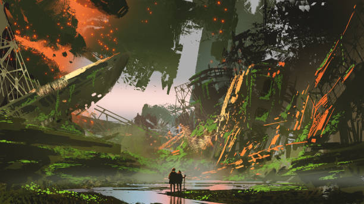

> Thanh niên kia từ đâu tới?
> Tại sao họ lại hành động như vậy?
> Họ là ai, nếu không phải chính chúng ta?
> Oh, vậy ra họ là, như kiểu, đồng loại mình ấy hả?

Chúng ta, ôi chao, khởi đầu từ những ngày thật khác. Mười ba ngàn năm sau khi băng tan, loài người lảo đảo bước trên muôn nẻo đường. Kẻ thì vung bút viết chữ, rèn sắt thành dao, dựng nên thành quách công nghiệp. Kẻ khác vẫn lững lờ săn thú, hái quả, sống đời du mục, để rồi cuối cùng bị những gã mạnh hơn đạp xuống, cuốn vào cơn lốc lịch sử.

Lịch sử thế giới, nói sao cho phải, như một vò rượu mạnh, vừa thơm vừa cay, uống vào là say mèm. Hết trận lụt này đến cơn bão khác, hết tai ương này lại vấp phải họa kia. Thỉnh thoảng, trời quang mây tạnh, lóe lên chút thanh bình như ánh trăng rằm, nhưng rồi sóng cồn ập đến, cuốn phăng tất cả. Chỉ còn lại vài hòn đảo lẻ loi, nhấp nhô giữa dòng đời, trước khi cũng bị chôn vùi.

Câu chuyện dưới đây là một ván cờ nhỏ, tóm gọn cái lịch sử hỗn độn của loài người. Hy vọng nó giúp huynh đài thấy rõ ta đã đi qua những gì, đang lẩn quẩn ở đâu, và liệu mai sau có đánh cược nổi với số phận hay không.

## Rời khỏi Châu Phi và vương ra thế giới

Hãy quay về 50.000 năm trước, khi tổ tiên ta còn lang thang trên thảo nguyên Đông Phi, tay cầm giáo đá, mắt láo liên tìm thú hoang, miệng nhai quả mọng chín đỏ. Nhìn thì chẳng khác gì đám vượn người lững lờ đi bằng hai chân, nhưng đừng để bộ dạng lừa! Trong đầu bọn họ, một ngọn lửa đã nhen nhóm.

Chẳng chỉ săn để no bụng, họ còn biết lập mưu, vẽ kế hoạch như tướng cờ trước trận đánh. Chẳng chỉ quấn da thú cho đỡ lạnh, họ còn tô vẽ cơ thể bằng màu đất, đeo trang sức như gã giang hồ khoe mẽ. Quan trọng hơn, họ biết kể chuyện, truyền kinh nghiệm qua đời này sang đời khác, hy vọng con cháu bớt khổ hơn cha ông. Chính cái đầu óc biết tưởng tượng, biết vẽ giấc mơ, và lưỡi biết nói thành lời đã làm nên Homo sapiens – một lũ điên rồ, dám thách thức cả đất trời.

Ngày ấy, nhân loại chỉ vài ngàn mạng, chen chúc vừa đủ một góc chợ. Nhưng đứng yên ư? Không đời nào! Cái máu giang hồ đã đẩy họ rời Đông Phi, liều mình tiến về phía bắc. Qua vài thế kỷ, dấu chân họ in khắp nơi: từ Lưỡi liềm Màu mỡ, nơi lúa mì đầu tiên mọc lên dưới nắng vàng, đến đồng cỏ Á-Âu bạt ngàn, rồi cả châu Âu lạnh giá. Chưa dừng lại, họ đóng thuyền thô sơ, vượt biển đến New Guinea, châu Úc. Chỉ vài ngàn năm, lũ con người đã phủ sóng ba phần tư quả đất. Thế giới, hóa ra, nhỏ bé hơn ta tưởng!

> Chờ một chút, vậy là trong khi một nền văn minh nào đó ở Ai Cập đã biết đến ướp xác và xây kim tự tháp thì ở vùng đất khác con người vẫn đang hú hú kẹc kẹc lùa bắt voi Mammoth à =)))
> →  Well, không chỉ vùng đất khác mà là phần lớn thế giời lúc 🫨

Từ buổi đầu Kỷ Holocene (~11.700 năm trước), loài người đã tung hoành khắp chốn. Mỗi tộc, mỗi vùng viết nên một chương sử riêng. Có nơi, lúa mì trải dài, làng mạc quây quần. Có chốn, dân du mục lang thang, sống nhờ trời đất ban cho. Nhưng ai mà đi chung đường bao giờ?

##  Hữu sản và vô sản
Chừng 10.000 năm trước ở Lưỡi liềm Màu mỡ, loài người giở chiêu mới, như kiếm khách tung tuyệt kỹ giữa trận chiến. Thay vì chạy theo thú hoang, họ học cách gieo hạt, thuần thú, biến đất cằn thành ruộng vườn. Ở Jericho (Palestine ngày nay, ~9000 TCN), những ngôi làng đầu tiên mọc lên, tường đá bao quanh để bảo vệ mùa màng. Một phát minh, nói sao cho phải, như nước cờ thần thánh, đảo lộn cả ván bài đời.

Trồng trọt chẳng chỉ là cách kiếm ăn. Nó sinh ra hữu sản – lũ nắm đất, giữ lúa mì, tích vàng bạc. Ở Sumer (Lưỡng Hà, ~4000 TCN), những kẻ sở hữu ruộng đất bắt đầu xây nhà to, tích kho lúa. Và tất nhiên, có hữu sản thì phải có vô sản – đám chỉ có đôi tay còng queo và cái lưng mỏi nhừ để bán sức. Chưa ai gọi tên “tầng lớp” lúc ấy, nhưng cái ranh giới giàu nghèo đã lặng lẽ vẽ ra, như lằn kiếm chia đôi giang hồ.

Canh tác mang lại thặng dư, nuôi sống làng mạc, dựng nên xã hội phức tạp. Ở Uruk (Lưỡng Hà, ~3500 TCN), dân số lên đến hàng chục ngàn, với đền thờ và chợ búa nhộn nhịp. Nhưng thặng dư cũng gieo mầm bất công. Đất đai thành báu vật, quyền sở hữu thành quyền lực. Những kẻ nắm mùa màng nhìn đám vô sản bằng nửa con mắt, như kiếm khách liếc lũ tiểu tốt. Từ đó, bất bình đẳng bén rễ, kéo dài qua ngàn năm.

Lấy ví dụ, ở Ai Cập cổ đại (~3000 TCN), pharaoh và quý tộc sở hữu đất đai màu mỡ bên sông Nile, trong khi nông dân và nô lệ còng lưng cày cấy, xây kim tự tháp. Hay ở thung lũng Indus (~2500 TCN), các thành phố như Mohenjo-Daro có hệ thống cống rãnh hiện đại, nhưng chỉ tầng lớp trên hưởng tiện nghi, còn đám thợ thủ công và lao động thì ngập trong mồ hôi. Cái ván cờ phân hóa này, từ Lưỡng Hà đến Trung Hoa, đã chia đôi thiên hạ: kẻ ngồi trên cao, người lầm lũi dưới thấp.

Bất công không chỉ là chuyện cơm áo. Khi luật Hammurabi (~1754 TCN) ra đời ở Babylon, nó công khai bảo vệ hữu sản, với những điều khoản như: “Kẻ đánh người tự do phải bồi thường, nhưng đánh nô lệ thì chỉ trả ít bạc.” Ôi chao, luật lệ cũng biết chọn mặt gửi vàng! Từ đây, xã hội không còn là bầy đàn chung sống, mà là đấu trường của quyền lực và của cải.

## Dấu mốc đầu tiên của loài vật bậc cao
Con người không phải loài duy nhất trên Trái Đất có tổ chức xã hội hay biết dùng công cụ. Nhưng chúng ta là loài đầu tiên tiến tới những bước đột phá mà không loài vật nào đạt được. Từ việc chế tạo công cụ bằng đá cách đây 2,5 triệu năm, đến việc biết tạo ra lửa khoảng 1 triệu năm trước, những dấu mốc này đã nâng Homo sapiens lên vị trí độc tôn trong tự nhiên.

Lửa là một trong những công cụ đầu tiên biến đổi cả thể chất lẫn văn hóa con người. Nó giúp nấu chín thức ăn, tiêu diệt vi khuẩn, và tạo ra nguồn năng lượng dễ tiêu hóa, thúc đẩy sự phát triển của bộ não lớn hơn. Cùng lúc đó, lửa cũng trở thành biểu tượng của quyền lực và văn hóa, là trung tâm của những buổi tụ họp trong đêm tối.

Chúng ta cũng phát minh ra ngôn ngữ, thứ đã trở thành dấu ấn đỉnh cao của loài vật bậc cao. Với ngôn ngữ, con người có thể truyền tải thông tin vượt thời gian và không gian, ghi lại ký ức, và sáng tạo ra những câu chuyện đầu tiên. Điều này không chỉ làm nên sự khác biệt của chúng ta, mà còn tạo ra nền tảng cho mọi phát minh sau này.
Thuở ban đầu, trồng trọt là một trong những phát minh vĩ đại nhất của con người. Nó không chỉ đơn thuần là cách kiếm ăn mới, mà còn là “đứa con đầu lòng” của một chủng loài luôn khao khát khám phá và chinh phục thế giới. Khi con người tìm ra cách kiểm soát cây cối, họ đã ghìm bước chân của mình lại, chấm dứt cuộc sống lang bạt của những người săn bắt hái lượm. Đây chính là khởi đầu cho một thời đại hoàn toàn mới: thời đại của định cư, tích trữ, và phân hóa xã hội.

Những hạt giống đầu tiên được gieo xuống đất mang theo niềm hy vọng của loài người về một cuộc sống ổn định và bền vững hơn. Nhưng đồng thời, chúng cũng gieo mầm cho những bất bình đẳng đầu tiên trong lịch sử. Khi một số người tích lũy được của cải từ mùa màng dư thừa, trong khi những người khác chỉ đủ ăn qua ngày, khoảng cách giữa hữu sản (những kẻ sở hữu đất đai, công cụ, và tài nguyên) và vô sản (những kẻ không có gì ngoài sức lao động) bắt đầu hình thành.

Ban đầu, sự bất bình đẳng này còn mờ nhạt. Các làng mạc nhỏ bé vẫn sống dựa trên sự hợp tác, chia sẻ, và giúp đỡ lẫn nhau. Nhưng khi con người bắt đầu canh tác quy mô lớn, trồng trọt thặng dư và tích lũy tài sản, xã hội dần thay đổi. Đất đai trở thành thứ có giá trị; quyền sở hữu trở thành sức mạnh; và sức lao động của con người trở thành hàng hóa. Từ đây, khái niệm quyền lực và sự áp bức dần xuất hiện.

Những nhà cai trị đầu tiên, dù là các tù trưởng, pháp sư, hay các nhà lãnh đạo tôn giáo, đều hiểu rằng việc kiểm soát đất đai và lương thực đồng nghĩa với việc kiểm soát con người. Họ xây dựng các cấu trúc xã hội để duy trì trật tự, nhưng đồng thời cũng củng cố quyền lực của riêng mình. Lần đầu tiên trong lịch sử, con người không còn đứng ngang hàng với nhau, mà bị chia cắt bởi của cải và quyền lực.

Điều này không chỉ xảy ra trong các làng mạc nhỏ bé, mà còn ở quy mô lớn hơn khi các nền văn minh đầu tiên xuất hiện. Từ các cánh đồng lúa mì của vùng Lưỡng Hà đến các thung lũng lúa nước của Trung Hoa, những kẻ nắm giữ quyền lực kinh tế dần trở thành tầng lớp thống trị. Đó là tầng lớp hữu sản, trong khi tầng lớp vô sản bị buộc phải làm việc quần quật để đổi lấy sự sinh tồn.

Trồng trọt, vốn là biểu tượng của sự sáng tạo và tiến bộ, giờ đây mang cả hai mặt: vừa là công cụ cho sự phát triển, vừa là nguồn gốc của bất công và xung đột xã hội. Và như vậy, cuộc xung đột giữa hữu sản và vô sản đã âm ỉ từ buổi bình minh của lịch sử loài người, kéo dài qua hàng nghìn năm, và vẫn còn để lại dấu ấn đến tận ngày nay.

## Tân thần mới của loài người - Tiền, chiến tranh và quyền lực
Khi xã hội phình to, con người chẳng còn chỉ lo cái bụng. Họ thờ những “tân thần” mới: tiền, chiến tranh, quyền lực – ba gã giang hồ dẫn dắt cả thiên hạ, vừa oai phong vừa tàn nhẫn.

Tiền, ban đầu chỉ là trò đổi chác vỏ sò, lông thú, hóa thành ông vua vô hình. Ở Sumer (~3000 TCN), người ta dùng shekel – những mảnh bạc có trọng lượng cố định – để mua bán, từ lúa mì đến đất đai. Tiền mua được hàng, mua được sức, mua cả thời gian. Nhưng nó cũng là con dao hai lưỡi, xé toạc xã hội bằng lòng tham. Ở Babylon, kẻ giàu xây cung điện, kẻ nghèo còng lưng trả nợ, như lũ tiểu tốt quỳ trước kiếm khách.

Chiến tranh, từ những trận đánh bộ lạc lẻ tẻ, thành trò chơi của kẻ mạnh. Ở Trận Kadesh (~1274 TCN), người Hittite và Ai Cập đụng độ, dùng cả chiến xa và cung tên, tranh quyền bá chủ Lưỡi liềm Màu mỡ. Chiến tranh tàn phá, cướp bóc, nhưng cũng sinh ra bánh xe (~3500 TCN ở Mesopotamia), lưỡi kiếm đồng, và chiến lược quân sự. Nó là lưỡi kiếm sắc, vừa phá vừa xây, vừa giết vừa nuôi.

  

Quyền lực, đích đến của mọi giang hồ. Tiền và chiến tranh chỉ là công cụ để leo lên ngai vàng. Ở Trung Hoa, nhà Thương (~1600 TCN) dùng đồng và chiến binh để thống trị, xây đền thờ và chôn sống cả trăm nô lệ để hầu vua dưới suối vàng. Các lãnh chúa, pháp sư, vua chúa dùng tiền và chiến tranh để đè đầu thiên hạ, viết nên những chương sử đẫm máu và vinh quang, từ Alexandros Đại đế (336 TCN) chinh phục nửa thế giới, đến Tần Thủy Hoàng (221 TCN) thống nhất Trung Hoa bằng kiếm và mưu.

Ba tân thần này, dù đáng sợ, đã vẽ nên bức tranh thế giới – nơi thành công xen lẫn bi kịch, tham vọng đan cài thất bại. Như gã kiếm khách đứng giữa chợ, vừa được tung hô, vừa bị nguyền rủa.

## Thế Nhân sinh
Mười ba ngàn năm, từ thảo nguyên Phi châu đến lò máy công nghiệp, loài người đi qua muôn nẻo đường. Kẻ viết chữ trên đất sét ở Sumer (~3200 TCN), rèn sắt thành kiếm ở Trung Quốc (~1200 TCN), xây thành công nghiệp ở Luân Đôn thế kỷ 19. Kẻ săn thú, hái quả, rồi bị kẻ mạnh nuốt chửng, như các bộ tộc Châu Mỹ khi Columbus đặt chân đến năm 1492. Lịch sử, nói sao cho phải, là một ván cờ hỗn loạn, nơi khát vọng va đập, đấu tranh tung hoành.

Giờ đây, đứng giữa thời đại cơ giới, ta nhìn lại, thấy nhớ cái “thiên đường đã mất” của thảo nguyên, của gió trời. Ở Amazon, bộ tộc Yanomami vẫn sống như tổ tiên ta 10.000 năm trước, nhưng bị máy xúc và súng đạn của “văn minh” đe dọa. Con người, lũ điên rồ ấy, chưa bao giờ ngừng tìm đáp án cho câu hỏi: “Ta sống vì cái quái gì?”

Và thế là, ta bước vào Thế Nhân sinh (Anthropocene) – thời đại mà lũ vượn thông minh này nắm quyền định đoạt cả sinh quyển. Non trẻ lắm, chỉ 2 triệu năm so với 4,5 tỷ năm của Hành Tinh Xanh, nhưng ta đã dám vung kiếm, khắc tên mình lên đá. Từ khi James Watt cải tiến máy hơi nước (1765), ta đẩy cả thế giới vào cơn lốc công nghiệp, đốt than, xẻ rừng, làm nóng hành tinh. (Lưu ý: Thế Anthropocene chưa chính thức trong thang địa chất, nhưng cứ nhìn cách ta phá làng phá xóm – từ ô nhiễm sông Dương Tử đến rừng Amazon cháy rụi – sớm muộn cũng thành hiện thực! 🍵)

  

Ta đã làm được gì? Biến sóng thành wifi, dựng Tử Cấm Thành, phóng tàu lên sao Hỏa. Nhưng cũng tự đào hố: 6 lần tuyệt chủng trong lịch sử Trái Đất, và lần này, ta có thể là thủ phạm. Thế nên, đây chính là một vụ đặt cược được-ăn-cả-ngã-về-không của bốn-tỷ-năm-sự-sống. Liệu chúng ta có thể lèo lái Hành Tinh Xanh hướng tới một tương lai thịnh vượng, nơi mà con người và tất cả các sinh vật khác — những sinh vật mà chúng ta phụ thuộc vào — có thể phát triển mạnh mẽ trong hàng ngàn, hoặc thậm chí có thể, trong hàng triệu năm tới trong tương lai hay không?

Liệu ta có đủ khôn ngoan để dừng lại, hay chỉ là một dòng chữ nhòe mực trong sách sử của hành tinh?

## Thảo luận thêm
Well, bắt đầu thế nào nhỉ, blog đầu tiên trong tưởng tượng của tôi là dành cho một nhân vật hay bộ phim anime nào đấy, chí ít không là Anime thì về kiếm hiệp, Kim Dung hay lại thao thao bất tuyệt về Tam Quốc. Nhưng có lẽ bắt đầu với một chủ đề lịch sử theo góc nhìn học giả cũng không tệ đến thế. Vậy điều gì đã đưa tôi tới chủ đề này, đó là muôn vàn câu hỏi trong đầu về từ cỏ cây và sông suối, làm sao một sinh vật có thể biến nó thành các giao động tần sóng và phát minh ra thứ kiệt tác gọi là mạng wifi. Liệu nhân loại có đủ khôn ngoan để tự cứu lấy mình? Hay chúng ta sẽ trở thành một ghi chú ngắn ngủi trong lược sử của hành tinh xanh?

🍻🍻🍻 !!! Cheers !!! 🍻🍻🍻

